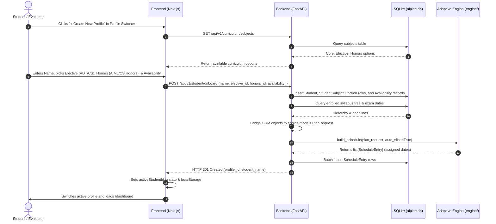
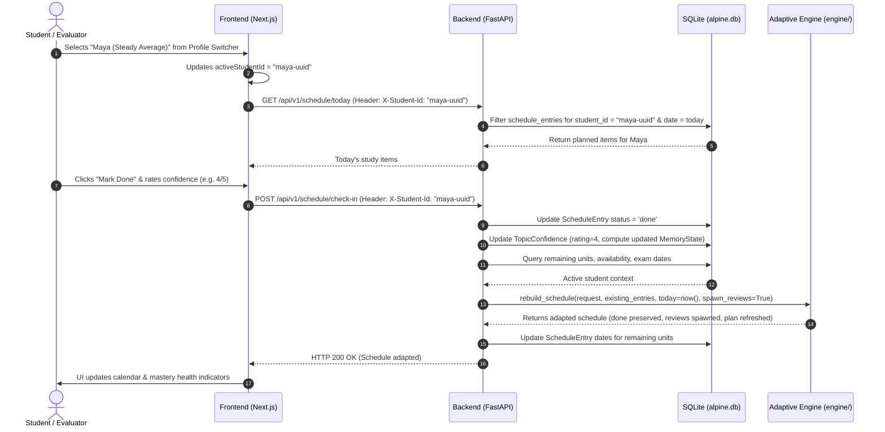

# Alpine — Frontend Elements & Backend Implementation Guide
**Document Type:** Technical Specification & Handover Reference  
**Audience:** Full-Stack / Backend & Frontend Developers (Member C)  
**Status:** Approved for Implementation  
**Version:** 2.0 (Local SQLite + SQLAlchemy & Profile Switcher)  

---

## 1. Executive Summary & Architecture Overview

### 1.1 Project Context
Alpine is an **Adaptive AI Study Mentor** scoped to a university semester curriculum. Rather than relying on generic LLM syllabus parsers or external third-party cloud APIs, Alpine operates entirely on local deterministic algorithms, constraint satisfaction programming (**Google OR-Tools CP-SAT**), and personalized forgetting curve mastery decay (**FSRS-inspired two-component memory retention**).

### 1.2 Local Architecture Shift (Zero Cloud Credentials)
To provide a 100% self-contained local experience for development, classroom demonstrations, and project vivas:
- **Database**: Cloud Supabase/PostgreSQL is replaced by **SQLAlchemy 2.0 with a local SQLite database (`alpine.db`)**. SQLite runs in **Write-Ahead Logging (WAL)** mode for concurrent reads/writes without database locks.
- **Identity & Authentication**: Cloud Supabase Auth (email/password, JWTs, email confirmation) is replaced by an interactive **Profile Switcher**. Evaluators and students can instantly switch between profiles (e.g. pre-seeded demo profiles: "Alex (Diligent Strong)", "Maya (Steady Average)", "Sam (Crammer)") or create unlimited custom profiles via the UI.
- **Storage Persistence**: All student profiles, enrollments, availability, and schedules are persistently stored in the local SQLite database. The client only stores the active student ID string in `localStorage` as a pointer.

```
+---------------------------------------------------------------------------------+
|                                 FRONTEND                                        |
|              (Next.js / React + Tailwind CSS + Lucide Icons)                    |
|                                                                                 |
|   +-----------------------+  +----------------+  +---------------+              |
|   |   Profile Switcher    |  |   Onboarding   |  |   Dashboard   |              |
|   |  (Alex, Maya, + New)  |  |  Wizard Flow   |  |   & Check-In  |              |
|   +-----------------------+  +----------------+  +---------------+              |
|   +-----------------------+  +----------------+                                 |
|   |   Calendar Schedule   |  |   Curriculum   |                                 |
|   |   & Timeline View     |  | Mastery Health |                                 |
|   +-----------------------+  +----------------+                                 |
+---------------------------------------+-----------------------------------------+
                                        |  HTTP / JSON + Header: X-Student-Id: <uuid>
                                        v
+---------------------------------------------------------------------------------+
|                                 BACKEND API                                     |
|                            (FastAPI + Pydantic v2)                              |
|                                                                                 |
|   +-----------------------+   +----------------------+   +------------------+   |
|   | Profile Dependency    |   | Router Endpoints     |   | Engine Bridge    |   |
|   | (X-Student-Id Header) |   | (Students/Schedule)  |   | (ORM <-> Engine) |   |
|   +-----------------------+   +----------------------+   +------------------+   |
+----------------------+---------------------------------------+------------------+
                       |                                       |
                       | SQLAlchemy 2.0 (Sync Session)         | Pure Python Call
                       v                                       v
+---------------------------------------------+ +---------------------------------+
|          LOCAL DATABASE (alpine.db)         | |       ADAPTIVE ENGINE (Member B)|
|             SQLite (WAL Mode)               | |            (engine/ package)    |
| - subjects, modules, topics, subtopics      | | - OR-Tools CP-SAT Solver        |
| - students, student_subjects, availability  | | - Prerequisite NetworkX DAG     |
| - topic_confidence, schedule_entries        | | - FSRS Stability & Retrievability|
| - exam_dates, topic_dependencies            | | - Dynamic Review Units & Slicing|
+---------------------------------------------+ +---------------------------------+
```

---

## 2. End-to-End System Workflows

### 2.1 Profile Creation & Onboarding Flow



### 2.2 Profile Switching & Daily Check-In Flow



---

## 3. Local Database Layer Specification (SQLAlchemy 2.0 & SQLite)

### 3.1 SQLite Engine & Session Configuration (`backend/app/db/session.py`)

SQLite requires specific connection arguments in multi-threaded web servers to prevent locking:
- `connect_args={"check_same_thread": False}`: Allows FastAPI request threads to interact with SQLite connections.
- `PRAGMA journal_mode=WAL`: Enables Write-Ahead Logging, allowing concurrent readers alongside writers.
- `PRAGMA foreign_keys=ON`: Enforces relational integrity across cascaded deletes.

```python
# backend/app/db/session.py
from sqlalchemy import create_engine, event
from sqlalchemy.orm import declarative_base, sessionmaker

SQLITE_URL = "sqlite:///./alpine.db"

engine = create_engine(
    SQLITE_URL,
    connect_args={"check_same_thread": False},
    echo=False,
)

@event.listens_for(engine, "connect")
def configure_sqlite_connection(dbapi_connection, connection_record):
    cursor = dbapi_connection.cursor()
    cursor.execute("PRAGMA journal_mode=WAL;")
    cursor.execute("PRAGMA foreign_keys=ON;")
    cursor.close()

SessionLocal = sessionmaker(autocommit=False, autoflush=False, bind=engine)
Base = declarative_base()
```

---

### 3.2 SQLAlchemy Declarative Models (`backend/app/db/models.py`)

All 11 relational tables mapped directly from Member A's curriculum seeds and progress schemas:

```python
# backend/app/db/models.py
import uuid
from datetime import datetime, date
from sqlalchemy import (
    Column, String, Integer, Float, Date, DateTime, ForeignKey,
    CheckConstraint, UniqueConstraint, JSON, Boolean
)
from sqlalchemy.orm import relationship
from app.db.session import Base

def gen_uuid() -> str:
    return str(uuid.uuid4())

class Subject(Base):
    __tablename__ = "subjects"
    id = Column(String, primary_key=True, default=gen_uuid)
    name = Column(String, nullable=False)
    category = Column(String, nullable=False)  # 'core', 'elective', 'honors'
    group_name = Column(String, nullable=True) # 'open_elective', 'honors', None

    modules = relationship("Module", back_populates="subject", cascade="all, delete-orphan")

class Module(Base):
    __tablename__ = "modules"
    id = Column(String, primary_key=True, default=gen_uuid)
    subject_id = Column(String, ForeignKey("subjects.id", ondelete="CASCADE"), nullable=False)
    name = Column(String, nullable=False)
    order_index = Column(Integer, nullable=False)
    assessment_phase = Column(String, nullable=False)  # 'UT1', 'UT2'

    subject = relationship("Subject", back_populates="modules")
    topics = relationship("Topic", back_populates="module", cascade="all, delete-orphan")

class Topic(Base):
    __tablename__ = "topics"
    id = Column(String, primary_key=True, default=gen_uuid)
    module_id = Column(String, ForeignKey("modules.id", ondelete="CASCADE"), nullable=False)
    name = Column(String, nullable=False)
    order_index = Column(Integer, nullable=False)
    est_difficulty = Column(Integer, default=3)  # 1 to 5
    est_hours = Column(Float, default=1.0)

    module = relationship("Module", back_populates="topics")
    subtopics = relationship("Subtopic", back_populates="topic", cascade="all, delete-orphan")

class Subtopic(Base):
    __tablename__ = "subtopics"
    id = Column(String, primary_key=True, default=gen_uuid)
    topic_id = Column(String, ForeignKey("topics.id", ondelete="CASCADE"), nullable=False)
    name = Column(String, nullable=False)
    order_index = Column(Integer, nullable=False)
    est_hours = Column(Float, default=0.5)

    topic = relationship("Topic", back_populates="subtopics")

class TopicDependency(Base):
    __tablename__ = "topic_dependencies"
    topic_id = Column(String, ForeignKey("topics.id", ondelete="CASCADE"), primary_key=True)
    depends_on_topic_id = Column(String, ForeignKey("topics.id", ondelete="CASCADE"), primary_key=True)

class Student(Base):
    __tablename__ = "students"
    id = Column(String, primary_key=True, default=gen_uuid)
    display_name = Column(String, nullable=False)
    created_at = Column(DateTime, default=datetime.utcnow)

    enrollments = relationship("StudentSubject", back_populates="student", cascade="all, delete-orphan")
    availability = relationship("Availability", back_populates="student", cascade="all, delete-orphan")
    confidence_ratings = relationship("TopicConfidence", back_populates="student", cascade="all, delete-orphan")
    schedule_entries = relationship("ScheduleEntry", back_populates="student", cascade="all, delete-orphan")

class StudentSubject(Base):
    __tablename__ = "student_subjects"
    student_id = Column(String, ForeignKey("students.id", ondelete="CASCADE"), primary_key=True)
    subject_id = Column(String, ForeignKey("subjects.id", ondelete="CASCADE"), primary_key=True)

    student = relationship("Student", back_populates="enrollments")
    subject = relationship("Subject")

class Availability(Base):
    __tablename__ = "availability"
    student_id = Column(String, ForeignKey("students.id", ondelete="CASCADE"), primary_key=True)
    day_of_week = Column(Integer, primary_key=True)  # 0 = Monday ... 6 = Sunday
    hours_available = Column(Float, nullable=False)

    student = relationship("Student", back_populates="availability")

class TopicConfidence(Base):
    __tablename__ = "topic_confidence"
    id = Column(String, primary_key=True, default=gen_uuid)
    student_id = Column(String, ForeignKey("students.id", ondelete="CASCADE"), nullable=False)
    topic_id = Column(String, ForeignKey("topics.id", ondelete="CASCADE"), nullable=False)
    subtopic_id = Column(String, ForeignKey("subtopics.id", ondelete="CASCADE"), nullable=True)
    confidence_rating = Column(Integer, nullable=False)  # 1 to 5
    memory_state = Column(JSON, nullable=True)           # Serialized MemoryState (S, D, reps, lapses)
    last_updated = Column(Date, default=date.today)

    student = relationship("Student", back_populates="confidence_ratings")

class ScheduleEntry(Base):
    __tablename__ = "schedule_entries"
    id = Column(String, primary_key=True, default=gen_uuid)
    student_id = Column(String, ForeignKey("students.id", ondelete="CASCADE"), nullable=False)
    topic_id = Column(String, ForeignKey("topics.id", ondelete="CASCADE"), nullable=False)
    subtopic_id = Column(String, ForeignKey("subtopics.id", ondelete="CASCADE"), nullable=True)
    scheduled_date = Column(Date, nullable=False)
    status = Column(String, default="planned")  # 'planned', 'done', 'skipped'
    is_review = Column(Boolean, default=False)  # True if spawned review session

    student = relationship("Student", back_populates="schedule_entries")

class ExamDate(Base):
    __tablename__ = "exam_dates"
    subject_id = Column(String, ForeignKey("subjects.id", ondelete="CASCADE"), primary_key=True)
    exam_type = Column(String, primary_key=True)  # 'UT1', 'UT2', 'end_sem'
    exam_date = Column(Date, nullable=False)
```

---

### 3.3 Automatic Startup Ingestion & Demo Seeding (`backend/app/db/init_db.py`)

When the backend boots up, if `alpine.db` is not populated, it creates all tables and ingests:
1. `core_subjects.json`, `electives.json`, and `honors.json` from `database/seed/curriculum/`.
2. `exam_dates.json` from `database/seed/curriculum/`.
3. Pre-seeds 3 realistic demo student profiles (`Alex - Diligent Strong`, `Maya - Steady Average`, `Sam - Crammer`) with baseline schedules so the evaluator can test immediately without any setup.

```python
# backend/app/db/init_db.py
from pathlib import Path
import json
from datetime import date
from app.db.session import SessionLocal, Base, engine
from app.db import models

PROJECT_ROOT = Path(__file__).resolve().parents[3]
SEED_DIR = PROJECT_ROOT / "database" / "seed" / "curriculum"

def init_database_if_empty():
    Base.metadata.create_all(bind=engine)
    db = SessionLocal()
    try:
        # Check if already seeded
        if db.query(models.Subject).count() > 0:
            return

        print("⚡ Populating local SQLite database from curriculum seeds...")
        # Ingest core, electives, honors, exam dates...
        # Create demo profiles (Alex, Maya, Sam)...
        db.commit()
        print("✅ Local database initialized with curriculum and demo profiles.")
    finally:
        db.close()
```

---

## 4. Backend Implementation Specification (FastAPI)

### 4.1 Backend Directory Structure
```
backend/
├── app/
│   ├── api/
│   │   ├── deps.py              # get_db & get_active_student (X-Student-Id resolver)
│   │   └── v1/
│   │       ├── router.py        # Master v1 router aggregator
│   │       ├── students.py      # Profile Switcher endpoints (list, create, switch, delete)
│   │       ├── curriculum.py    # Subjects and full syllabus tree queries
│   │       ├── student.py       # Onboarding, profile details, availability updates
│   │       └── schedule.py      # Calendar viewing, today's focus, check-in, recalculate
│   ├── core/
│   │   └── config.py            # SQLite URL & CORS origins
│   ├── db/
│   │   ├── session.py           # SQLAlchemy 2.0 Engine & SessionLocal with WAL PRAGMAs
│   │   ├── models.py            # Declarative SQLite models
│   │   └── init_db.py           # Auto-seed logic from curriculum JSON files
│   ├── models/                  # Pydantic request & response schemas
│   │   ├── student.py
│   │   ├── curriculum.py
│   │   └── schedule.py
│   ├── services/
│   │   ├── engine_bridge.py     # SQLite rows <-> engine.models.PlanRequest
│   │   └── student_service.py   # Student lifecycle & onboarding logic
│   └── main.py                  # FastAPI app with lifespan startup hook
├── requirements.txt
└── README.md
```

---

### 4.2 Profile Switcher Identity Dependency (`app/api/deps.py`)

No passwords or JWT tokens are required. Every student-specific endpoint uses the `get_active_student` dependency, which reads the `X-Student-Id` request header and fetches the student record from SQLite. If the header is missing, it falls back to the first available student or prompts selection.

```python
# backend/app/api/deps.py
from fastapi import Header, HTTPException, Depends, status
from sqlalchemy.orm import Session
from app.db.session import SessionLocal
from app.db import models

def get_db():
    db = SessionLocal()
    try:
        yield db
    finally:
        db.close()

def get_active_student(
    x_student_id: str | None = Header(default=None, alias="X-Student-Id"),
    db: Session = Depends(get_db)
) -> models.Student:
    if not x_student_id:
        # Fallback to the first available profile in the database
        student = db.query(models.Student).order_by(models.Student.created_at.asc()).first()
        if not student:
            raise HTTPException(
                status_code=status.HTTP_404_NOT_FOUND,
                detail="No student profiles found. Please create a profile first."
            )
        return student

    student = db.query(models.Student).filter(models.Student.id == x_student_id).first()
    if not student:
        raise HTTPException(
            status_code=status.HTTP_404_NOT_FOUND,
            detail=f"Student profile '{x_student_id}' does not exist."
        )
    return student
```

---

### 4.3 REST API Endpoints Specification

#### 1. Profile Switcher Endpoints (`/api/v1/students`)

##### `GET /api/v1/students`
- **Description**: Returns all student profiles stored in the local SQLite database for the Profile Switcher dropdown.
- **Response `200 OK`**:
```json
[
  {
    "id": "student-uuid-1",
    "display_name": "Alex (Diligent Strong)",
    "enrolled_subjects_count": 6,
    "completed_units": 24,
    "total_units": 142,
    "created_at": "2026-09-01T10:00:00"
  },
  {
    "id": "student-uuid-2",
    "display_name": "Maya (Steady Average)",
    "enrolled_subjects_count": 5,
    "completed_units": 15,
    "total_units": 120,
    "created_at": "2026-09-01T10:00:00"
  }
]
```

##### `POST /api/v1/students`
- **Description**: Creates a new student profile in the SQLite database and initiates onboarding.
- **Request Body**:
```json
{
  "display_name": "Custom Learner"
}
```
- **Response `201 Created`**:
```json
{
  "id": "new-student-uuid",
  "display_name": "Custom Learner",
  "message": "Profile created successfully. Proceed to onboarding."
}
```

##### `DELETE /api/v1/students/{student_id}`
- **Description**: Deletes a student profile and cascades all enrolled subjects, availability, ratings, and schedule entries from SQLite.
- **Response `200 OK`**: `{"message": "Profile deleted successfully"}`

---

#### 2. Curriculum Endpoints (`/api/v1/curriculum`)

##### `GET /api/v1/curriculum/subjects`
- **Description**: Returns all subjects grouped by category (`core`, `electives`, `honors`) for the onboarding wizard.

##### `GET /api/v1/curriculum/tree`
- **Description**: Returns the full syllabus hierarchy (Subjects -> Modules -> Topics -> Subtopics).

---

#### 3. Student Onboarding & Availability (`/api/v1/student`)

##### `POST /api/v1/student/onboard`
- **Description**: Completes onboarding for the active profile: auto-enrolls all core subjects, registers the chosen elective and honors option, persists the 7-day availability matrix, invokes `engine.scheduler.baseline.build_schedule`, and stores schedule entries in SQLite.
- **Header**: `X-Student-Id: <uuid>` (or passed in body)
- **Request Body**:
```json
{
  "student_id": "new-student-uuid",
  "elective_id": "adt-uuid",
  "honors_id": "aiml-uuid", // optional / null
  "availability": [
    {"day_of_week": 0, "hours_available": 2.5},
    {"day_of_week": 1, "hours_available": 2.0},
    {"day_of_week": 2, "hours_available": 2.0},
    {"day_of_week": 3, "hours_available": 2.5},
    {"day_of_week": 4, "hours_available": 1.5},
    {"day_of_week": 5, "hours_available": 4.0},
    {"day_of_week": 6, "hours_available": 3.0}
  ],
  "start_date": "2026-09-01"
}
```
- **Response `201 Created`**:
```json
{
  "message": "Onboarding complete and study plan generated",
  "student_id": "new-student-uuid",
  "total_scheduled_units": 142
}
```

##### `PUT /api/v1/student/availability`
- **Description**: Updates weekly availability and triggers automatic schedule recalculation via `engine.scheduler.adaptive.rebuild_schedule`.
- **Header**: `X-Student-Id: <uuid>`

---

#### 4. Schedule & Adaptive Check-In (`/api/v1/schedule`)

##### `GET /api/v1/schedule`
- **Description**: Returns planned, completed, and review entries for the active student within a date range.
- **Header**: `X-Student-Id: <uuid>`

##### `GET /api/v1/schedule/today`
- **Description**: Returns today's scheduled units, daily study target in hours, and exam countdowns.
- **Header**: `X-Student-Id: <uuid>`

##### `POST /api/v1/schedule/check-in`
- **Description**: Records topic completion and 1–5 confidence score. Computes updated `MemoryState` (stability & retrievability), marks entry `done`, and recalculates remaining schedule via `rebuild_schedule` (dynamically spawning review units if $R < 0.75$).
- **Header**: `X-Student-Id: <uuid>`
- **Request Body**:
```json
{
  "unit_id": "subtopic:uuid-45",
  "status": "done",
  "confidence_rating": 4
}
```
- **Response `200 OK`**:
```json
{
  "message": "Check-in logged and schedule dynamically adapted",
  "unit_id": "subtopic:uuid-45",
  "stability_days": 6.8,
  "retrievability": 1.0,
  "recalculated_units_count": 138
}
```

---

### 4.4 Engine Bridge Implementation (`app/services/engine_bridge.py`)

Translates SQLite ORM rows into the engine's Pydantic models:

```python
# backend/app/services/engine_bridge.py
from datetime import date
from sqlalchemy.orm import Session
from app.db import models
from engine.models import (
    AssessmentPhase,
    Availability as EngineAvailability,
    ConfidenceRating as EngineConfidenceRating,
    ExamDate as EngineExamDate,
    ExamType as EngineExamType,
    MemoryState,
    PlanRequest,
    SchedulableUnit,
    ScheduleEntry,
)
from engine.scheduler.baseline import build_schedule
from engine.scheduler.adaptive import rebuild_schedule

class EngineBridge:
    @staticmethod
    def build_plan_request_from_db(student_id: str, db: Session, start_date: date) -> PlanRequest:
        student = db.query(models.Student).filter(models.Student.id == student_id).first()
        enrolled_subject_ids = [e.subject_id for e in student.enrollments]

        # 1. Query curriculum and build SchedulableUnit objects (Leaf Unit Fallback Rule)
        units = []
        modules = db.query(models.Module).filter(models.Module.subject_id.in_(enrolled_subject_ids)).all()
        for mod in modules:
            for top in mod.topics:
                # Query dependencies
                dep_rows = db.query(models.TopicDependency).filter(models.TopicDependency.topic_id == top.id).all()
                dep_ids = [d.depends_on_topic_id for d in dep_rows]

                if top.subtopics:
                    for sub in top.subtopics:
                        units.append(
                            SchedulableUnit(
                                unit_id=f"subtopic:{sub.id}",
                                topic_id=top.id,
                                subtopic_id=sub.id,
                                subject_id=mod.subject_id,
                                module_id=mod.id,
                                name=sub.name,
                                order_index=sub.order_index,
                                est_difficulty=max(1, top.est_difficulty - 1),
                                est_hours=sub.est_hours,
                                depends_on=[f"topic:{d}" for d in dep_ids],
                                assessment_phase=AssessmentPhase(mod.assessment_phase),
                            )
                        )
                else:
                    units.append(
                        SchedulableUnit(
                            unit_id=f"topic:{top.id}",
                            topic_id=top.id,
                            subtopic_id=None,
                            subject_id=mod.subject_id,
                            module_id=mod.id,
                            name=top.name,
                            order_index=top.order_index,
                            est_difficulty=top.est_difficulty,
                            est_hours=top.est_hours,
                            depends_on=[f"topic:{d}" for d in dep_ids],
                            assessment_phase=AssessmentPhase(mod.assessment_phase),
                        )
                    )

        # 2. Query confidence & memory state
        confidence = []
        conf_rows = db.query(models.TopicConfidence).filter(models.TopicConfidence.student_id == student_id).all()
        for c in conf_rows:
            uid = f"subtopic:{c.subtopic_id}" if c.subtopic_id else f"topic:{c.topic_id}"
            mem = MemoryState(**c.memory_state) if c.memory_state else None
            confidence.append(
                EngineConfidenceRating(
                    unit_id=uid,
                    rating=c.confidence_rating,
                    last_updated=c.last_updated,
                    memory_state=mem,
                )
            )

        # 3. Query availability
        avail_rows = db.query(models.Availability).filter(models.Availability.student_id == student_id).all()
        availability = [
            EngineAvailability(day_of_week=a.day_of_week, hours_available=a.hours_available)
            for a in avail_rows
        ]

        # 4. Query exam dates
        exam_rows = db.query(models.ExamDate).filter(models.ExamDate.subject_id.in_(enrolled_subject_ids)).all()
        exam_dates = [
            EngineExamDate(
                subject_id=e.subject_id,
                exam_type=EngineExamType(e.exam_type),
                exam_date=e.exam_date,
            )
            for e in exam_rows
        ]

        return PlanRequest(
            student_id=student_id,
            units=units,
            confidence=confidence,
            availability=availability,
            exam_dates=exam_dates,
            start_date=start_date,
        )
```

---

## 5. Frontend Elements & UI/UX Specification (React / Next.js)

### 5.1 Profile Switcher Component (`<ProfileSwitcher />`)

The centerpiece of the application header, replacing the login button:

```tsx
// frontend/src/components/layout/ProfileSwitcher.tsx
import React, { useEffect, useState } from "react";
import { User, ChevronDown, Plus, Check } from "lucide-react";
import { useStudentProfiles } from "@/hooks/useStudentProfiles";

export function ProfileSwitcher() {
  const { profiles, activeProfile, setActiveProfileId } = useStudentProfiles();
  const [isOpen, setIsOpen] = useState(false);

  return (
    <div className="relative">
      <button
        onClick={() => setIsOpen(!isOpen)}
        className="flex items-center gap-2 px-3 py-1.5 rounded-lg border bg-card hover:bg-accent text-sm font-medium transition-colors"
      >
        <div className="w-6 h-6 rounded-full bg-primary/10 text-primary flex items-center justify-center font-bold text-xs">
          {activeProfile?.display_name.charAt(0) || "U"}
        </div>
        <span>{activeProfile?.display_name || "Select Profile"}</span>
        <ChevronDown className="w-4 h-4 text-muted-foreground" />
      </button>

      {isOpen && (
        <div className="absolute right-0 mt-2 w-64 rounded-xl border bg-card shadow-lg py-1 z-50">
          <div className="px-3 py-2 text-xs font-semibold text-muted-foreground border-b">
            Active Student Profiles
          </div>

          <div className="max-h-60 overflow-y-auto py-1">
            {profiles.map((p) => (
              <button
                key={p.id}
                onClick={() => {
                  setActiveProfileId(p.id);
                  setIsOpen(false);
                }}
                className="w-full flex items-center justify-between px-3 py-2 text-sm hover:bg-accent text-left transition-colors"
              >
                <div>
                  <div className="font-medium">{p.display_name}</div>
                  <div className="text-xs text-muted-foreground">
                    {p.completed_units} / {p.total_units} units done
                  </div>
                </div>
                {p.id === activeProfile?.id && <Check className="w-4 h-4 text-primary" />}
              </button>
            ))}
          </div>

          <div className="border-t pt-1">
            <a
              href="/onboarding"
              className="flex items-center gap-2 px-3 py-2 text-sm text-primary hover:bg-accent font-medium transition-colors"
            >
              <Plus className="w-4 h-4" />
              <span>Create New Profile</span>
            </a>
          </div>
        </div>
      )}
    </div>
  );
}
```

---

### 5.2 API Client Interceptor (`lib/api.ts`)

Every HTTP request automatically attaches `X-Student-Id` read from the client state/localStorage:

```ts
// frontend/src/lib/api.ts
import axios from "axios";

export const apiClient = axios.create({
  baseURL: process.env.NEXT_PUBLIC_API_URL || "http://localhost:8000/api/v1",
});

apiClient.interceptors.request.use((config) => {
  const activeStudentId = localStorage.getItem("active_student_id");
  if (activeStudentId) {
    config.headers["X-Student-Id"] = activeStudentId;
  }
  return config;
});
```

---

### 5.3 Page & Route Layout

| Route | Role / Description |
|---|---|
| `/` | Redirects to `/dashboard` with the active profile (or triggers profile creation if database has 0 profiles). |
| `/dashboard` | **Command Center**: Today's Focus task list, duration badges, difficulty meters, exam countdown, and quick check-in buttons. |
| `/onboarding` | **Profile Creation Wizard**: Enter student name, select Open Elective (`ADT` vs `CS`), toggle Honors (`AIML` vs `CS Honors`), and set 7-day Weekly Availability Matrix. |
| `/schedule` | **Interactive Calendar**: Month Grid, Week Agenda, and Chronological List view with highlighted UT1/UT2/End-Sem flags. |
| `/curriculum` | **Syllabus & Mastery Explorer**: Hierarchical accordion showing topics and decayed mastery health indicators (Green: Fresh, Yellow: Decaying/Review soon, Red: Weak). |
| `/settings` | **Availability & Profile Editor**: Adjust weekly study hours and trigger schedule re-balancing. |

---

## 6. Developer Handover Checklist & One-Command Setup

Member C can set up and run the entire full-stack project locally in under 3 minutes with zero cloud accounts:

### Step 1: Backend Setup & Launch
```bash
# 1. Navigate to project root and create virtual environment
python -m venv backend/.venv
.\backend\.venv\Scripts\Activate.ps1

# 2. Install dependencies
pip install fastapi uvicorn sqlalchemy pydantic -r engine/requirements.txt

# 3. Start the FastAPI server
uvicorn backend.app.main:app --reload --port 8000
```
*Result*: The backend boots up, checks for `alpine.db`, automatically creates all SQLite tables, seeds the curriculum from JSON files, and creates the demo profiles (`Alex`, `Maya`, `Sam`).

### Step 2: Frontend Setup & Launch
```bash
# 1. Navigate to frontend directory
cd frontend
npm install

# 2. Run Next.js local server
npm run dev
```
*Result*: Open `http://localhost:3000` in the browser. The Profile Switcher loads immediately in the header with pre-seeded demo learners ready for testing.
