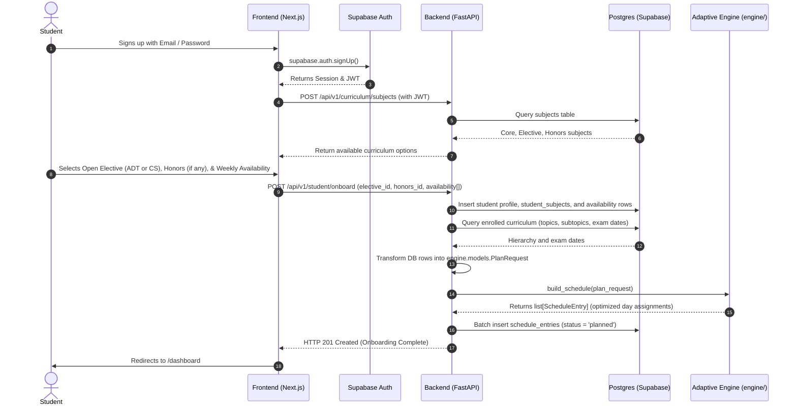
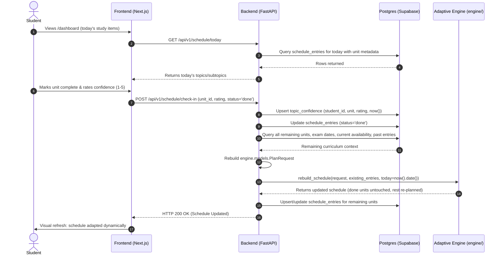

# Alpine — Frontend Elements & Backend Implementation Guide
**Document Type:** Technical Specification & Handover Reference  
**Audience:** Full-Stack / Backend & Frontend Developers (Member C)  
**Status:** Approved for Implementation  
**Version:** 1.0  

---

## 1. Executive Summary & Architecture Overview

### 1.1 Project Context
Alpine is an **Adaptive AI Study Mentor** scoped to a university semester curriculum. Rather than relying on generic LLM syllabus parsers or external third-party AI APIs, Alpine operates entirely on local deterministic algorithms, constraint satisfaction programming (**Google OR-Tools CP-SAT**), and forgetting curve mastery decay.

### 1.2 Team Division & Scope Boundary
The project is architected across three decoupled workstreams:
- **Member A (Data & Content Layer — `database/`)**: Completed. Manages Supabase PostgreSQL schemas, curriculum seed data (`core`, `electives`, `honors`), exam dates, Row Level Security (RLS), and synthetic student generators.
- **Member B (Adaptive Engine — `engine/`)**: Completed. A pure Python package implementing prerequisite DAG validation ([`networkx`](file:///c:/Users/Lenovo/Desktop/project/Alpine%20project/Alpine/engine/mastery/dependency_dag.py)), confidence-decay mastery modeling ([`engine/mastery/confidence_model.py`](file:///c:/Users/Lenovo/Desktop/project/Alpine%20project/Alpine/engine/mastery/confidence_model.py)), CP-SAT baseline scheduling ([`engine/scheduler/baseline.py`](file:///c:/Users/Lenovo/Desktop/project/Alpine%20project/Alpine/engine/scheduler/baseline.py)), and dynamic re-scheduling ([`engine/scheduler/adaptive.py`](file:///c:/Users/Lenovo/Desktop/project/Alpine%20project/Alpine/engine/scheduler/adaptive.py)).
- **Member C (Application & Interface — `backend/` & `frontend/`)**: **Target of this document.** Responsible for implementing the FastAPI REST backend (Supabase authentication, database queries, engine orchestration) and the responsive React/Next.js frontend user interface.

```
+---------------------------------------------------------------------------------+
|                                 FRONTEND                                        |
|              (Next.js / React + Tailwind CSS + Lucide Icons)                    |
|                                                                                 |
|   +---------------+  +----------------+  +---------------+  +---------------+   |
|   |  Auth Pages   |  |   Onboarding   |  |   Dashboard   |  |   Calendar    |   |
|   |  (Login/Reg)  |  |  Wizard Flow   |  |   & Check-In  |  |  & Curriculum |   |
|   +---------------+  +----------------+  +---------------+  +---------------+   |
+---------------------------------------+-----------------------------------------+
                                        |  HTTP / JSON + Supabase JWT
                                        v
+---------------------------------------------------------------------------------+
|                                 BACKEND API                                     |
|                            (FastAPI + Pydantic v2)                              |
|                                                                                 |
|   +-----------------------+   +----------------------+   +------------------+   |
|   | Auth & RLS Middleware |   | Router Endpoints     |   | Engine Bridge    |   |
|   | (Token Verification)  |   | (Curriculum/Student) |   | (DB <-> Pydantic)|   |
|   +-----------------------+   +----------------------+   +------------------+   |
+----------------------+---------------------------------------+------------------+
                       |                                       |
                       | SQL / PostgREST Client                | In-Memory Call
                       v                                       v
+---------------------------------------------+ +---------------------------------+
|             DATABASE (Member A)             | |       ADAPTIVE ENGINE (Member B)|
|          Supabase / PostgreSQL              | |            (engine/ package)    |
| - subjects, modules, topics, subtopics      | | - OR-Tools CP-SAT Solver        |
| - students, student_subjects, availability  | | - Prerequisite NetworkX DAG     |
| - topic_confidence, schedule_entries        | | - Decay Mastery & Urgency       |
| - exam_dates, baseline_schedules            | | - build_schedule / rebuild      |
+---------------------------------------------+ +---------------------------------+
```

---

## 2. End-to-End System Workflow

### 2.1 Student Onboarding Flow



### 2.2 Daily Check-In & Adaptive Re-scheduling Flow



---

## 3. Database Schema & Engine Integration Contracts

The database layer was configured by Member A in migrations `0001` through `0004`. The backend must communicate with these tables while respecting Row Level Security (RLS).

### 3.1 Database Tables Reference

| Table | Primary Key | Key Attributes | Notes / Relationships |
|---|---|---|---|
| `subjects` | `id (uuid)` | `name`, `category` (`core`\|`elective`\|`honors`), `group_name` (`open_elective`\|`honors`\|NULL) | Read-only for authenticated users. |
| `modules` | `id (uuid)` | `subject_id (FK)`, `name`, `order_index`, `assessment_phase` (`UT1`\|`UT2`) | Determines whether unit falls under UT1 or UT2. |
| `topics` | `id (uuid)` | `module_id (FK)`, `name`, `order_index`, `est_difficulty` (1–5), `est_hours` | Fallback schedulable unit if subtopics are absent. |
| `subtopics` | `id (uuid)` | `topic_id (FK)`, `name`, `order_index`, `est_hours` | **Primary schedulable unit** when present. |
| `topic_dependencies`| `(topic_id, depends_on_topic_id)` | Prerequisite links between topics | Defined at topic level. |
| `students` | `id (uuid)` | Mirrors Supabase `auth.users.id`, `display_name`, `created_at` | Thin student profile. |
| `student_subjects` | `(student_id, subject_id)` | Enrollment records | Managed during onboarding. |
| `availability` | `(student_id, day_of_week)`| `day_of_week` (0–6), `hours_available` (numeric) | 0=Monday through 6=Sunday (ISO 8601). |
| `topic_confidence` | `id (uuid)` | `student_id`, `topic_id`, `subtopic_id` (nullable), `confidence_rating` (1–5), `last_updated`, `memory_state` (jsonb nullable) | Unique on `(student, topic, subtopic)` or `(student, topic)`. Stores FSRS stability & retrievability state. |
| `schedule_entries` | `id (uuid)` | `student_id`, `topic_id`, `subtopic_id` (nullable), `scheduled_date`, `status` (`planned`\|`done`\|`skipped`), `is_review` (bool) | Calendar schedule per student, flagged for initial study vs spaced review. |
| `exam_dates` | `(subject_id, exam_type)` | `exam_type` (`UT1`\|`UT2`\|`end_sem`), `exam_date` | Reference deadlines. |
| `baseline_schedules`| `id (uuid)` | `subject_id`, `topic_id`, `subtopic_id`, `suggested_order` | Synthetic reference order. |

---

### 3.2 The Leaf Schedulable Unit Rule (Translation Contract)

The engine does not distinguish between topics and subtopics; it processes a flat list of `SchedulableUnit` objects. The backend **must** perform this translation using the following PRD rule:

1. **If a topic has subtopics**:
   - Each subtopic becomes its own `SchedulableUnit`.
   - `unit_id`: `"subtopic:<subtopic_uuid>"`
   - `subtopic_id`: `<subtopic_uuid>`
   - `topic_id`: `<topic_uuid>`
   - `est_hours`: `subtopic.est_hours`
   - `est_difficulty`: `topic.est_difficulty` (or `max(1, topic.est_difficulty - 1)`)
   - `depends_on`: Prerequisite unit IDs mapped from `topic_dependencies`.
2. **If a topic has NO subtopics**:
   - The topic itself becomes the `SchedulableUnit`.
   - `unit_id`: `"topic:<topic_uuid>"`
   - `subtopic_id`: `None`
   - `topic_id`: `<topic_uuid>`
   - `est_hours`: `topic.est_hours`
   - `est_difficulty`: `topic.est_difficulty`
   - `depends_on`: Prerequisite unit IDs mapped from `topic_dependencies`.

---

## 4. Backend Implementation Specification (FastAPI)

### 4.1 Recommended Technology Stack
- **Framework**: FastAPI (Python 3.12+)
- **Validation**: Pydantic v2
- **Database Client**: `supabase-py` (or `postgrest-py` / `asyncpg` with direct connection pooling)
- **Authentication**: Supabase JWT validation via `PyJWT` or `gotrue`
- **Engine**: Direct local import from `engine` package (`from engine.scheduler.baseline import build_schedule`, etc.)
- **Server**: Uvicorn / Gunicorn

### 4.2 Backend Directory Structure
```
backend/
├── app/
│   ├── api/
│   │   ├── deps.py              # Auth dependencies & Supabase client injection
│   │   └── v1/
│   │       ├── router.py        # Central v1 APIRouter aggregator
│   │       ├── auth.py          # Student profile creation & token validation
│   │       ├── curriculum.py    # Subject, module, and hierarchy exploration
│   │       ├── student.py       # Onboarding, profile, availability endpoints
│   │       └── schedule.py      # Schedule viewing, today's focus, check-in, recalculate
│   ├── core/
│   │   ├── config.py            # Environment settings (Pydantic BaseSettings)
│   │   └── security.py          # JWT verification & Supabase token parsing
│   ├── models/                  # Pydantic request & response schemas
│   │   ├── curriculum.py
│   │   ├── student.py
│   │   └── schedule.py
│   ├── services/
│   │   ├── engine_bridge.py     # Bridges DB records to engine.models.PlanRequest
│   │   └── schedule_service.py  # Orchestrates baseline & adaptive scheduling calls
│   └── main.py                  # FastAPI initialization, CORS middleware, exception handlers
├── tests/
│   ├── test_api_curriculum.py
│   ├── test_api_onboarding.py
│   └── test_api_checkin.py
├── .env.example
└── requirements.txt
```

---

### 4.3 Environment Configuration (`.env`)
```bash
# Supabase Configuration
SUPABASE_URL="https://your-project.supabase.co"
SUPABASE_KEY="your-anon-public-key"
SUPABASE_SERVICE_ROLE_KEY="your-service-role-key"  # Used for system operations only
SUPABASE_JWT_SECRET="your-supabase-jwt-secret"

# Server Settings
BACKEND_HOST="0.0.0.0"
BACKEND_PORT=8000
CORS_ORIGINS="http://localhost:3000,http://127.0.0.1:3000"
```

---

### 4.4 Authentication & Security Dependency (`app/api/deps.py`)

Every protected endpoint requires an authenticated Supabase user token. The dependency extracts the Bearer token, validates the JWT with the Supabase JWT secret, and provides the `current_user_id`:

```python
from fastapi import Depends, HTTPException, status
from fastapi.security import HTTPBearer, HTTPAuthorizationCredentials
import jwt
from app.core.config import settings

security = HTTPBearer()

def get_current_user_id(credentials: HTTPAuthorizationCredentials = Depends(security)) -> str:
    token = credentials.credentials
    try:
        payload = jwt.decode(
            token,
            settings.SUPABASE_JWT_SECRET,
            algorithms=["HS256"],
            audience="authenticated"
        )
        user_id = payload.get("sub")
        if not user_id:
            raise HTTPException(status_code=status.HTTP_401_UNAUTHORIZED, detail="Invalid token")
        return user_id
    except jwt.PyJWTError as e:
        raise HTTPException(status_code=status.HTTP_401_UNAUTHORIZED, detail=f"Authentication failed: {str(e)}")
```

---

### 4.5 REST API Endpoints Specification

#### 1. Curriculum Endpoints

##### `GET /api/v1/curriculum/subjects`
- **Description**: Returns all subjects grouped by category (`core`, `open_elective`, `honors`) for the onboarding picker.
- **Auth**: Authenticated
- **Response `200 OK`**:
```json
{
  "core": [
    {"id": "uuid-1", "name": "Software Engineering and Agile Practices", "category": "core"},
    {"id": "uuid-2", "name": "Web Technology", "category": "core"},
    {"id": "uuid-3", "name": "Embedded Systems and RTOS", "category": "core"}
  ],
  "electives": [
    {"id": "uuid-4", "name": "Advanced Database Technologies", "code": "ADT", "group_name": "open_elective"},
    {"id": "uuid-5", "name": "Cyber Security", "code": "CS", "group_name": "open_elective"}
  ],
  "honors": [
    {"id": "uuid-6", "name": "Artificial Intelligence and Machine Learning", "code": "AIML", "group_name": "honors"},
    {"id": "uuid-7", "name": "Ethical Hacking", "code": "CS Honors", "group_name": "honors"}
  ]
}
```

##### `GET /api/v1/curriculum/tree`
- **Description**: Returns complete hierarchical syllabus tree (subjects -> modules -> topics -> subtopics) for syllabus exploration and progress tracking.
- **Auth**: Authenticated

---

#### 2. Student & Onboarding Endpoints

##### `POST /api/v1/student/onboard`
- **Description**: Performs one-time student onboarding. Auto-enrolls all core subjects, enrolls the chosen elective and honors subject, saves weekly availability, generates the baseline schedule using the engine, and saves schedule entries.
- **Auth**: Authenticated (`student_id` extracted from JWT)
- **Request Body**:
```json
{
  "elective_id": "uuid-4",
  "honors_id": "uuid-6", // Optional, null if student opted out
  "availability": [
    {"day_of_week": 0, "hours_available": 2.5},
    {"day_of_week": 1, "hours_available": 2.0},
    {"day_of_week": 2, "hours_available": 2.0},
    {"day_of_week": 3, "hours_available": 2.5},
    {"day_of_week": 4, "hours_available": 1.5},
    {"day_of_week": 5, "hours_available": 4.0},
    {"day_of_week": 6, "hours_available": 3.0}
  ],
  "start_date": "2026-09-01" // Optional, defaults to today
}
```
- **Response `201 Created`**:
```json
{
  "message": "Onboarding completed and initial schedule generated",
  "student_id": "user-uuid",
  "enrolled_subjects_count": 6,
  "total_scheduled_units": 142,
  "schedule_start_date": "2026-09-01"
}
```
- **Error Response `422 Unprocessable Entity`**:
  If the student's highest single-day availability is smaller than any individual topic duration:
```json
{
  "detail": "Unit 'Distributed Databases' requires 2.0h, but your largest available day is only 1.5h. Please increase availability on at least one day."
}
```

##### `GET /api/v1/student/profile`
- **Description**: Returns student profile, list of enrolled subjects, and current weekly availability.
- **Auth**: Authenticated

##### `PUT /api/v1/student/availability`
- **Description**: Updates the student's weekly study availability and triggers an automatic adaptive schedule recalculation.
- **Auth**: Authenticated
- **Request Body**:
```json
{
  "availability": [
    {"day_of_week": 0, "hours_available": 3.0},
    {"day_of_week": 1, "hours_available": 3.0}
  ]
}
```
- **Response `200 OK`**: Updated schedule summary.

---

#### 3. Schedule & Adaptive Check-In Endpoints

##### `GET /api/v1/schedule`
- **Description**: Returns scheduled entries for the student. Accepts query parameters `from_date` and `to_date` (defaults to current month).
- **Auth**: Authenticated
- **Response `200 OK`**:
```json
[
  {
    "id": "entry-uuid-1",
    "unit_id": "subtopic:uuid-10",
    "subject_id": "uuid-1",
    "subject_name": "Software Engineering and Agile Practices",
    "module_name": "Introduction to Software Engineering",
    "topic_name": "Prescriptive Process Models",
    "subtopic_name": "Waterfall Model",
    "scheduled_date": "2026-09-02",
    "est_hours": 1.5,
    "est_difficulty": 2,
    "status": "planned",
    "assessment_phase": "UT1"
  }
]
```

##### `GET /api/v1/schedule/today`
- **Description**: Returns study units planned for today, current day's total scheduled hours, and countdown to upcoming UT1/UT2/End-Sem exams.
- **Auth**: Authenticated
- **Response `200 OK`**:
```json
{
  "today_date": "2026-09-05",
  "total_hours_today": 2.5,
  "items": [
    {
      "entry_id": "entry-uuid-1",
      "unit_id": "subtopic:uuid-10",
      "subject_name": "Software Engineering",
      "title": "Waterfall Model",
      "est_hours": 1.0,
      "est_difficulty": 2,
      "status": "planned"
    }
  ],
  "upcoming_exams": [
    {"subject_name": "Software Engineering", "exam_type": "UT1", "exam_date": "2026-09-30", "days_remaining": 25}
  ]
}
```

##### `POST /api/v1/schedule/check-in`
- **Description**: Submits student self-assessment for a completed unit. Saves confidence rating, updates entry status to `done`, and recalculates remaining schedule via `engine.scheduler.adaptive.rebuild_schedule`.
- **Auth**: Authenticated
- **Request Body**:
```json
{
  "unit_id": "subtopic:uuid-10",
  "status": "done", // "done" | "skipped"
  "confidence_rating": 3 // 1 to 5 (required if status == "done")
}
```
- **Response `200 OK`**:
```json
{
  "message": "Check-in recorded and schedule dynamically adapted",
  "unit_id": "subtopic:uuid-10",
  "recorded_confidence": 3,
  "normalized_mastery": 0.5,
  "recalculated_units_count": 141
}
```

##### `GET /api/v1/student/progress`
- **Description**: Aggregates syllabus completion percentage per subject, average confidence, and mastery health indicators.
- **Auth**: Authenticated

---

### 4.6 Engine Bridge Implementation Details (`app/services/engine_bridge.py`)

This bridge encapsulates the translation between database records and the pure Python engine models:

```python
from datetime import date
from engine.models import (
    AssessmentPhase,
    Availability as EngineAvailability,
    ConfidenceRating as EngineConfidenceRating,
    ExamDate as EngineExamDate,
    ExamType as EngineExamType,
    PlanRequest,
    SchedulableUnit,
    ScheduleEntry,
)
from engine.scheduler.baseline import build_schedule
from engine.scheduler.adaptive import rebuild_schedule

class EngineBridge:
    @staticmethod
    def build_plan_request(
        student_id: str,
        db_curriculum_rows: list[dict],
        db_confidence_rows: list[dict],
        db_availability_rows: list[dict],
        db_exam_dates: list[dict],
        start_date: date
    ) -> PlanRequest:
        # 1. Transform raw curriculum into SchedulableUnit objects
        units = []
        for row in db_curriculum_rows:
            unit_id = f"subtopic:{row['subtopic_id']}" if row.get("subtopic_id") else f"topic:{row['topic_id']}"
            units.append(
                SchedulableUnit(
                    unit_id=unit_id,
                    topic_id=str(row["topic_id"]),
                    subtopic_id=str(row["subtopic_id"]) if row.get("subtopic_id") else None,
                    subject_id=str(row["subject_id"]),
                    module_id=str(row["module_id"]),
                    name=row.get("subtopic_name") or row["topic_name"],
                    order_index=row["order_index"],
                    est_difficulty=row["est_difficulty"],
                    est_hours=float(row["est_hours"]),
                    depends_on=row.get("prerequisite_unit_ids", []),
                    assessment_phase=AssessmentPhase(row["assessment_phase"])
                )
            )

        # 2. Transform confidence
        confidence = [
            EngineConfidenceRating(
                unit_id=r["unit_id"],
                rating=r["confidence_rating"],
                last_updated=r["last_updated"].date() if hasattr(r["last_updated"], "date") else r["last_updated"]
            )
            for r in db_confidence_rows
        ]

        # 3. Transform availability
        availability = [
            EngineAvailability(
                day_of_week=r["day_of_week"],
                hours_available=float(r["hours_available"])
            )
            for r in db_availability_rows
        ]

        # 4. Transform exam dates
        exam_dates = [
            EngineExamDate(
                subject_id=str(r["subject_id"]),
                exam_type=EngineExamType(r["exam_type"]),
                exam_date=r["exam_date"]
            )
            for r in db_exam_dates
        ]

        return PlanRequest(
            student_id=student_id,
            units=units,
            confidence=confidence,
            availability=availability,
            exam_dates=exam_dates,
            start_date=start_date
        )

    @staticmethod
    def generate_baseline(request: PlanRequest) -> list[ScheduleEntry]:
        return build_schedule(request)

    @staticmethod
    def recalculate_adaptive(
        request: PlanRequest,
        existing_entries: list[ScheduleEntry],
        today: date
    ) -> list[ScheduleEntry]:
        return rebuild_schedule(request, existing_entries, today=today)
```

---

## 5. Frontend Elements & UI/UX Specification (React / Next.js)

### 5.1 Recommended Frontend Stack
- **Framework**: Next.js 14+ (App Router) or React + Vite
- **Styling**: Tailwind CSS
- **Component Primitives**: Radix UI / `shadcn/ui`
- **Icons**: `lucide-react`
- **State & Server Cache**: `@tanstack/react-query` (React Query)
- **Forms & Validation**: `react-hook-form` + `zod`
- **Date Utilities**: `date-fns`
- **Auth Client**: `@supabase/supabase-js`

### 5.2 Application Route Structure
```
frontend/src/
├── app/
│   ├── (auth)/
│   │   ├── login/page.tsx           # Email/Password Sign-In
│   │   └── signup/page.tsx          # New Student Registration
│   ├── (protected)/
│   │   ├── layout.tsx               # App shell with Sidebar & TopNav
│   │   ├── onboarding/page.tsx      # 4-Step Onboarding Wizard
│   │   ├── dashboard/page.tsx       # Main Student Command Center (Today's Focus)
│   │   ├── schedule/page.tsx        # Calendar & Timeline View
│   │   ├── curriculum/page.tsx      # Syllabus Tree & Mastery Tracker
│   │   └── settings/page.tsx        # Availability Matrix & Preferences
│   └── layout.tsx
├── components/
│   ├── onboarding/
│   │   ├── CoreSubjectsStep.tsx
│   │   ├── ElectivePickerStep.tsx
│   │   ├── HonorsSelectorStep.tsx
│   │   └── AvailabilityMatrixStep.tsx
│   ├── dashboard/
│   │   ├── DailyTaskCard.tsx
│   │   ├── ExamCountdownCard.tsx
│   │   └── ConfidenceModal.tsx
│   ├── schedule/
│   │   ├── CalendarMonthView.tsx
│   │   ├── WeekAgendaView.tsx
│   │   └── ScheduleFilterBar.tsx
│   └── ui/                          # Button, Modal, Card, Slider, Badges
├── lib/
│   ├── api.ts                       # Axios / fetch wrapper injecting Supabase JWT
│   └── supabaseClient.ts            # Supabase browser client
```

---

### 5.3 Screen-by-Screen Component Specifications

#### Screen 1: Onboarding Wizard (`/onboarding`)
A multi-step, interactive onboarding experience required before accessing the dashboard.

1. **Step 1: Core Curriculum Confirmation**
   - Displays 4–5 core subjects in read-only cards.
   - Shows subject badges, total module counts, and credit info.
   - Microcopy: *"Every student is automatically enrolled in all core subjects for this semester."*
2. **Step 2: Open Elective Picker**
   - Interactive two-card selector:
     - Card A: **Advanced Database Technologies (`ADT`)**
     - Card B: **Cyber Security (`CS`)**
   - Displays short syllabus summary. Selected card highlights with border and check icon.
3. **Step 3: Honors Program Selection (Optional)**
   - Toggle switch: *"Are you enrolled in an Honors specialization?"*
   - If toggled ON, displays two radio options:
     - **Artificial Intelligence and Machine Learning (`AIML`)**
     - **Ethical Hacking (`CS Honors`)**
   - If toggled OFF, student proceeds with core + 1 elective only.
4. **Step 4: Weekly Availability Matrix**
   - 7-day grid (Monday through Sunday).
   - Each day features an hours slider ($0.0\text{h}$ to $6.0\text{h}$) and numeric input.
   - Real-time indicator displaying:
     - Total weekly available hours (e.g., $18.5\text{h} / \text{week}$).
     - Maximum single-day session capacity.
     - Warning banner if any day has $< 1.0\text{h}$ and max day is insufficient.
5. **Submission & Plan Generation**:
   - Primary CTA: *"Generate My Study Plan"*.
   - Loading overlay: *"Running constraint solver and optimizing schedule for unit test deadlines..."*

---

#### Screen 2: Today's Focus & Dashboard (`/dashboard`)
The daily student landing page designed for frictionless execution and check-in.

1. **Header Banner**:
   - Current date, daily study budget (e.g., *"Today: 2.5 hours planned"*).
   - Quick progress ring: completed vs planned units for the day.
2. **Today's Schedulable Unit Cards**:
   - Card displays:
     - **Subject Tag**: Color-coded pill (e.g., Blue for Software Engineering, Purple for AIML).
     - **Hierarchy Breadcrumb**: `Module 1 > Requirement Engineering > SRS`.
     - **Estimated Duration**: e.g. `⏱️ 1.5 hrs`.
     - **Cognitive Difficulty**: 1–5 visual rating meter.
     - **Assessment Phase Tag**: `UT1` or `UT2`.
   - Card Actions:
     - Primary button: **"Mark Done & Check-In"** (opens Confidence Check-In Modal).
     - Secondary button: **"Postpone"** (reschedules to next available slot).
3. **Upcoming Exam Countdown Widget**:
   - Cards showing upcoming exams:
     - e.g., *"Software Engineering UT1 — in 18 days"*
     - Visual urgency bar color-coded by days remaining (Green > 20d, Amber 10-20d, Red < 10d).

---

#### Screen 3: Confidence Rating Modal (`<ConfidenceModal />`)
Triggered immediately when a student clicks "Mark Done" on a topic.

- **Modal Title**: *"Session Complete: How well do you know this topic?"*
- **Subject & Topic**: Name of the completed unit.
- **Interactive 1–5 Rating Buttons** with explicit self-assessment descriptors:
  - `⭐ 1 - Struggling`: *"Need fundamental revision soon"*
  - `⭐ 2 - Shaky`: *"Understood basics, but had trouble with exercises"*
  - `⭐ 3 - Moderate`: *"Comfortable with standard questions"*
  - `⭐ 4 - Good`: *"High clarity, minor doubts only"*
  - `⭐ 5 - Mastered`: *"Thoroughly confident, exam-ready"*
- **Adaptive Guarantee Notice**:
  > *"Alpine will adjust future sessions based on this score: lower confidence prioritizes this topic for earlier review, while high confidence frees up your schedule for weaker topics."*
- **Action Buttons**:
  - `[Submit Rating]` -> Calls `POST /api/v1/schedule/check-in`, triggers toast notification: *"Schedule dynamically updated!"*.

---

#### Screen 4: Interactive Calendar & Schedule (`/schedule`)
- **View Toggles**:
  - **Month View**: Traditional calendar grid displaying color-coded unit blocks on assigned dates.
  - **Week View**: Time-blocked day columns with daily hour totals at top.
  - **List / Timeline View**: Sequential list of remaining units grouped by week.
- **Exam Milestone Indicators**:
  - UT1, UT2, and End-Semester dates pinned as prominent banner flags across calendar days.
- **Status Filter**:
  - Toggle between `Planned`, `Completed`, and `All`.

---

#### Screen 5: Curriculum & Mastery Tracker (`/curriculum`)
- **Hierarchical Accordion Explorer**:
  - Top level: Enrolled Subjects.
  - Mid level: Modules tagged with `UT1` or `UT2` phase badges.
  - Leaf level: Topics and subtopics.
- **Decayed Mastery Visualization**:
  - Next to each leaf topic:
    - **Mastery Score Badge**:
      - 🟢 Green (Mastery $\ge 0.75$): Freshly mastered.
      - 🟡 Yellow ($0.40 \le \text{Mastery} < 0.75$): Moderate or decaying confidence; review suggested soon.
      - 🔴 Red ($\text{Mastery} < 0.40$): Low confidence or stale knowledge.
      - ⚪ Gray: Not yet studied.
    - Last studied date (e.g., *"Rated 4/5 — 16 days ago (decay active)"*).

---

#### Screen 6: Availability & Preferences (`/settings`)
- Allows students to adjust their weekly study hours at any time during the semester.
- Modifying hours triggers `PUT /api/v1/student/availability`, calling the engine's `rebuild_schedule` to re-balance the remaining semester workload.

---

## 6. Frontend Error Handling & Edge Cases

| Scenario / Error | Backend Response | Frontend Handling & UI Feedback |
|---|---|---|
| **Unit requires more hours than max single day** | `422 Unprocessable Entity` (`UnschedulableUnitError`) | Modal dialog: *"Availability constraint: [Topic Name] requires [X] hours, but your highest available day is only [Y] hours. Please increase your availability on at least one day in settings."* |
| **Insufficient time before End-Semester** | `400 Bad Request` (`RuntimeError`) | Warning alert: *"The remaining workload exceeds your available hours before the End-Semester exam date. Consider allocating additional hours per week to complete the full curriculum."* |
| **Unauthenticated / Expired Session** | `401 Unauthorized` | Automatically redirects to `/login` with return URL query param. |
| **Network failure during Check-In** | Network Error | Retains optimistic check-in state locally, shows retry banner: *"Failed to sync with scheduler. Retrying..."* |

---

## 7. Developer Handover & Implementation Roadmap

Follow this step-by-step checklist to implement Member C's full-stack layer:

### Phase 1: Environment & Auth Scaffolding
- [ ] Create a Supabase project and execute database migrations `0001` through `0004` in order.
- [ ] Run `python database/seed/seed_runner.py` to populate curriculum and exam dates.
- [ ] Initialize `backend/` directory with FastAPI and install requirements: `fastapi`, `uvicorn`, `pydantic>=2.5.0`, `supabase`, `pyjwt`, plus the local `engine` dependencies (`ortools`, `networkx`).
- [ ] Implement Supabase JWT verification dependency in `backend/app/api/deps.py`.

### Phase 2: Backend API & Engine Integration
- [ ] Implement `GET /api/v1/curriculum/subjects` to serve core, elective, and honors subjects.
- [ ] Implement `EngineBridge` in `backend/app/services/engine_bridge.py` mapping DB rows into `engine.models.PlanRequest` via the **Leaf Schedulable Unit Rule**.
- [ ] Implement `POST /api/v1/student/onboard`:
  - Inserts student enrollments into `student_subjects`.
  - Inserts daily hours into `availability`.
  - Calls `engine.scheduler.baseline.build_schedule`.
  - Batch inserts returned entries into `schedule_entries`.
- [ ] Implement `GET /api/v1/schedule` and `GET /api/v1/schedule/today`.
- [ ] Implement `POST /api/v1/schedule/check-in`:
  - Upserts `topic_confidence`.
  - Updates entry status to `done`.
  - Calls `engine.scheduler.adaptive.rebuild_schedule`.
  - Updates database with newly scheduled dates.

### Phase 3: Frontend Interface Development
- [ ] Initialize Next.js project with Tailwind CSS and `shadcn/ui`.
- [ ] Implement authentication pages (`/login`, `/signup`) with Supabase Auth client.
- [ ] Build the 4-step Onboarding Wizard (`/onboarding`) with Core subjects overview, Elective selector, Honors toggle, and Availability matrix.
- [ ] Build the Student Dashboard (`/dashboard`) displaying today's tasks, estimated hours, and exam countdowns.
- [ ] Build the `<ConfidenceModal />` check-in modal with 1–5 rating options and feedback microcopy.
- [ ] Build the Calendar View (`/schedule`) supporting month, week, and list views.
- [ ] Build the Curriculum Explorer (`/curriculum`) showing topic breakdown and decayed confidence badges.

### Phase 4: Verification & Integration Walkthrough
- [ ] **End-to-End Test 1 (Onboarding)**: Register a new test user, select `ADT` elective and `AIML` honors, set 2.0h daily availability, and confirm 100+ schedule entries are generated.
- [ ] **End-to-End Test 2 (Adaptive Low-Confidence)**: Mark a topic complete with a rating of `1/5`. Verify that related topics or early revisions are prioritized sooner in the schedule.
- [ ] **End-to-End Test 3 (Adaptive High-Confidence & Decay)**: Mark a topic with `5/5`. Advance simulated date or verify that confident topics leave room for weaker topics.
- [ ] **End-to-End Test 4 (Availability Adjustment)**: Change Sunday availability to 0h in settings and verify that no topics are scheduled on Sundays.
